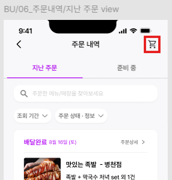

# [레거시] 9-9 주문내역 장바구니 진입

> **레거시 문서** · 과거 구현과 로깅을 확인하기 위한 보존 자료입니다.

[← 새 주변상점 - 레거시 로깅 목록](README.md)

플랫폼: ANDROID · IOS  
원문 상태: 로깅 필요

원문에 과거·새 로깅 구분이 없어 아래 정의와 참고사진을 원문 순서로 표시합니다.

원문 미기재 항목: `event_name`, `screen_view`, `value`. 값을 추정하지 않았습니다.

event\_params.key

- event\_label : orderHistory\_cart

- value : 

- event\_category : click

- previous\_page :

- current\_page :

- duration\_time :

---

원문 정보

원본 ID: `86a0221954bc82f7887e013e7425918a`  
[보존 원문](../../_archive/original/notion/pages/86a0221954bc82f7887e013e7425918a.md)

