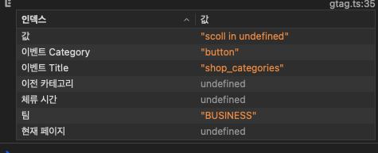
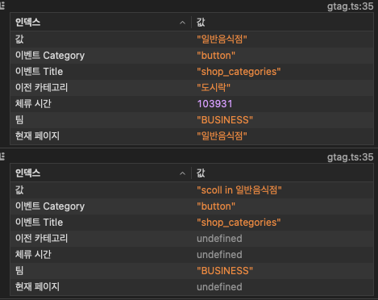

# 해결 (1)

[← 새 주변상점 - 레거시 목록](README.md)

플랫폼:   
원문 상태:   
[Notion 기준 명세](https://app.notion.com/p/d510221954bc82f4a15581a2282b795b)  
원본 ID: `d510221954bc82f4a15581a2282b795b`

<!-- notion-body:start -->
웹: 

- 헤더나 푸터를 통하여 주변상점을 들어가게 될때 생기는 문제



→ 헤더나 푸터를 통하여 들어가게 되면 undefined가 아닌 전체보기를 넣어주시면 감사하겠습니다. 

- 스크롤 이후 카테고리를 변경하면 자동으로 스크롤 이벤트가 감지되고 있는 이슈



→ 카테고리 변경할 때 안 생기게 처리해주시면 감사하겠습니다…!
<!-- notion-body:end -->

<details>
<summary>Notion 원문 속성 전체</summary>

```json
{
  "title": "해결 (1)"
}
```

</details>
