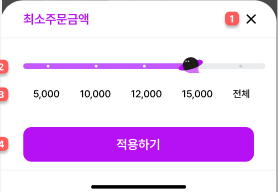

# 2-14 상점 카테고리 최소주문금액 설정

[← 미래의 주변상점 - 레거시 목록](README.md)

플랫폼: ANDROID, IOS  
원문 상태: 로깅 필요  
[Notion 기준 명세](https://app.notion.com/p/c8e0221954bc8225b72e0171c8c9fc95)  
원본 ID: `c8e0221954bc8225b72e0171c8c9fc95`

<!-- notion-body:start -->


금액을 설정하고 적용하기를 눌렀을 때 발생하는 로깅

event\_params.key

- event\_label : min\_amount\_set
- value : 금액
- event\_category : click
<!-- notion-body:end -->

<details>
<summary>Notion 원문 속성 전체</summary>

```json
{
  "platform": [
    "ANDROID",
    "IOS"
  ],
  "url": "https://app.notion.com/p/c8e0221954bc8225b72e0171c8c9fc95",
  "상태": "로깅 필요",
  "생성일": "2026-11-23T13:39:14.744Z",
  "이벤트 이름": "2-14 상점 카테고리 최소주문금액 설정",
  "태그": [
    "2. 상점 카테고리"
  ]
}
```

</details>
