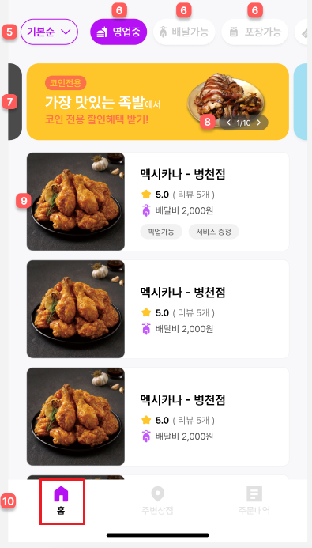

# 2-15 상점 카테고리 → 홈

[← 미래의 주변상점 - 레거시 목록](README.md)

플랫폼: ANDROID, IOS  
원문 상태: 로깅 필요  
[Notion 기준 명세](https://app.notion.com/p/bba0221954bc82419e87811df7e73f68)  
원본 ID: `bba0221954bc82419e87811df7e73f68`

<!-- notion-body:start -->


event\_params.key

- event\_label : shop\_categories\_home
- value :  \{카테고리\}
- event\_category : click
- duration\_time : 이전 페이지에서 현재  페이지(홈)으로 이동하는 시간
- previous\_page : \{이전 페이지\}
- current\_page : \{홈\}
<!-- notion-body:end -->

<details>
<summary>Notion 원문 속성 전체</summary>

```json
{
  "platform": [
    "ANDROID",
    "IOS"
  ],
  "url": "https://app.notion.com/p/bba0221954bc82419e87811df7e73f68",
  "상태": "로깅 필요",
  "생성일": "2026-11-23T13:39:14.800Z",
  "이벤트 이름": "2-15 상점 카테고리 → 홈",
  "태그": [
    "2. 상점 카테고리"
  ]
}
```

</details>
