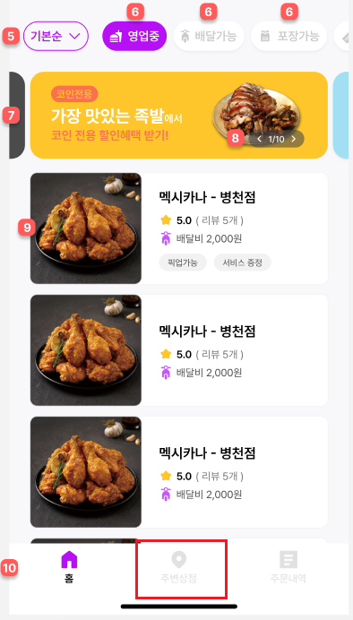

# 2-16 상점 카테고리 → 주변상점

[← 미래의 주변상점 - 레거시 목록](README.md)

플랫폼: ANDROID, IOS  
원문 상태: 로깅 필요  
[Notion 기준 명세](https://app.notion.com/p/60e0221954bc83f6938481532c7e8372)  
원본 ID: `60e0221954bc83f6938481532c7e8372`

<!-- notion-body:start -->
- 앱 내 간편결제 주문이 불가능한 상점 페이지로 이동



event\_params.key

- event\_label : shop\_categories\_nearby
- value :  \{카테고리\}
- event\_category : click
- duration\_time : 이전 페이지에서 현재 페이지(주변상점)로 이동하는 시간
- previous\_page : \{이전 페이지\}
- current\_page : \{주변상점\}
<!-- notion-body:end -->

<details>
<summary>Notion 원문 속성 전체</summary>

```json
{
  "platform": [
    "ANDROID",
    "IOS"
  ],
  "url": "https://app.notion.com/p/60e0221954bc83f6938481532c7e8372",
  "상태": "로깅 필요",
  "생성일": "2026-11-23T13:39:15.867Z",
  "이벤트 이름": "2-16 상점 카테고리 → 주변상점",
  "태그": [
    "2. 상점 카테고리"
  ]
}
```

</details>
