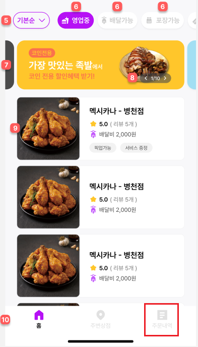

# 2-17 상점 카테고리 → 주문내역

[← 미래의 주변상점 - 레거시 목록](README.md)

플랫폼: ANDROID, IOS  
원문 상태: 로깅 필요  
[Notion 기준 명세](https://app.notion.com/p/0d30221954bc833e9c608116495e140b)  
원본 ID: `0d30221954bc833e9c608116495e140b`

<!-- notion-body:start -->


event\_params.key

- event\_label : shop\_categories\_order
- value :
- event\_category : click
- duration\_time : 이전 페이지에서 현재 페이지(주문내역)로 이동하는 시간
- previous\_page : \{이전 페이지\}
- current\_page : \{주문내역\}
<!-- notion-body:end -->

<details>
<summary>Notion 원문 속성 전체</summary>

```json
{
  "platform": [
    "ANDROID",
    "IOS"
  ],
  "url": "https://app.notion.com/p/0d30221954bc833e9c608116495e140b",
  "상태": "로깅 필요",
  "생성일": "2026-11-23T13:39:15.933Z",
  "이벤트 이름": "2-17 상점 카테고리 → 주문내역",
  "태그": [
    "2. 상점 카테고리"
  ]
}
```

</details>
