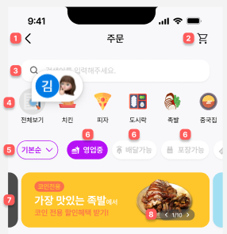

# 2-18 상점 카테고리 이탈

[← 미래의 주변상점 - 레거시 로깅 목록](README.md)

플랫폼: ANDROID · IOS  
원문 상태: 로깅 필요

원문에 과거·새 로깅 구분이 없어 아래 정의와 참고사진을 원문 순서로 표시합니다.

원문 미기재 항목: `event_name`, `screen_view`, `value`, `event_category`. 값을 추정하지 않았습니다.

1번 좌측 상단 버튼으로 이탈하는 로깅입니다

event\_params.key

- event\_label : shop\_categories\_back

- value : 

- event\_category : 

- click 

- swipe

- duration\_time : 이전 카테고리에서 메인(코인 홈 화면) 이탈하는 시간 

- previous\_page : \{이전 카테고리\}

- current\_page : 메인

---

원문 정보

원본 ID: `db10221954bc83d6ac5e81c547567b14`  
[보존 원문](../../_archive/original/notion/pages/db10221954bc83d6ac5e81c547567b14.md)

