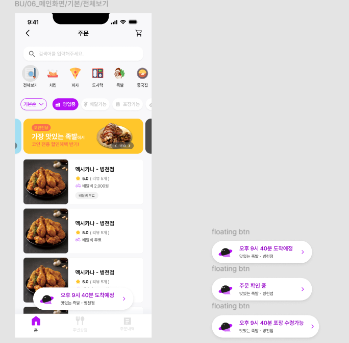

# 2-19 상점 카테고리 → 플로팅 바

[← 미래의 주변상점 - 레거시 로깅 목록](README.md)

원문 상태: 로깅 필요

원문에 과거·새 로깅 구분이 없어 아래 정의와 참고사진을 원문 순서로 표시합니다.

원문 미기재 항목: `event_name`, `screen_view`, `value`, `event_category`. 값을 추정하지 않았습니다.

event\_params.key

- event\_label : shop\_categories\_floating

- value : 

- event\_category : 

- click 

- duration\_time : 

- previous\_page : 

- current\_page : 

---

원문 정보

원본 ID: `9420221954bc839dbdb5010fa69204f3`  
[보존 원문](../../_archive/original/notion/pages/9420221954bc839dbdb5010fa69204f3.md)

