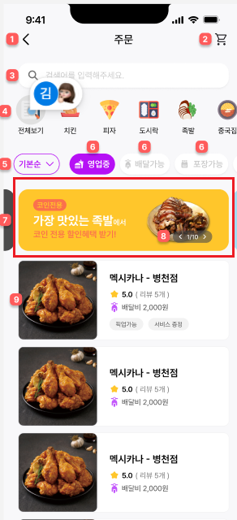

# [레거시] 2-3 상점카테고리 이벤트 (클릭)

> **레거시 문서** · 과거 구현과 로깅을 확인하기 위한 보존 자료입니다.

[← 미래의 주변상점 - 레거시 로깅 목록](README.md)

플랫폼: ANDROID · IOS  
원문 상태: 로깅 필요

원문에 과거·새 로깅 구분이 없어 아래 정의와 참고사진을 원문 순서로 표시합니다.

원문 미기재 항목: `event_name`, `screen_view`. 값을 추정하지 않았습니다.

event\_params.key

- event\_label : shop\_categories\_event

- value : \{가게이름\}

- event\_category : click 

- duration\_time : 이전 카테고리에서 현 상점으로 이동하는 시간 

- previous\_page : \{이전 카테고리\}

- current\_page : \{가게이름\}

---

---

원문 정보

원본 ID: `f320221954bc83b29de1816de358d1f1`  
[보존 원문](../../_archive/original/notion/pages/f320221954bc83b29de1816de358d1f1.md)

