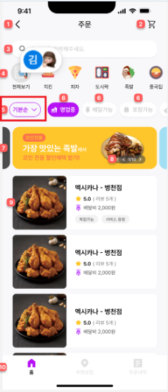
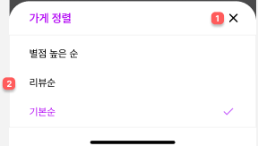

# [레거시] 2-6~8 상점 카테고리 정렬

> **레거시 문서** · 과거 구현과 로깅을 확인하기 위한 보존 자료입니다.

[← 미래의 주변상점 - 레거시 로깅 목록](README.md)

플랫폼: ANDROID · IOS  
원문 상태: 로깅 필요

원문에 과거·새 로깅 구분이 없어 아래 정의와 참고사진을 원문 순서로 표시합니다.

원문 미기재 항목: `event_name`, `screen_view`, `value`. 값을 추정하지 않았습니다.

기존 기능 및 디자인 → 로깅 수정 및 추가(오른쪽 사진)

event\_params.key

- event\_label : shop\_can

- value : 

- check\_delivery\_\{카테고리\}
- check\_review\_\{카테고리\}
- check\_star\_\{카테고리\}
- check\_open\_\{카테고리\}

- event\_category : click 

event\_params.key

- event\_label : shop\_can

- value : 

- check\_default\_\{카테고리\}
- check\_review\_\{카테고리\}
- check\_star\_\{카테고리\}

- event\_category : click 

---

메인화면이 아닌 주변상점 view의 경우에도 동일하게

로깅 심어주시면 됩니다 !

event\_params.key

- event\_label : shop\_can

- value : 

- check\_default\_\{카테고리\}
- check\_review\_\{카테고리\}
- check\_star\_\{카테고리\}

- event\_category : click 

---

원문 정보

원본 ID: `a2e0221954bc825a999a01752b5b6d47`  
[보존 원문](../../_archive/original/notion/pages/a2e0221954bc825a999a01752b5b6d47.md)

