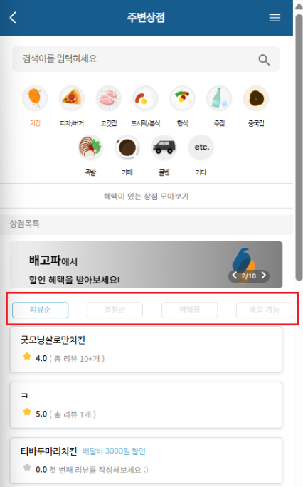
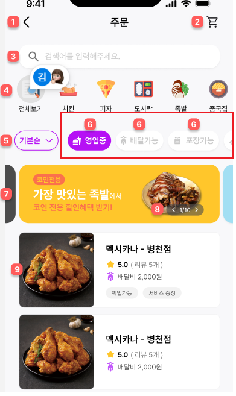

# 2-9 ~ 13 상점 카테고리 필터

[← 미래의 주변상점 - 레거시 목록](README.md)

플랫폼: ANDROID, IOS  
원문 상태: 로깅 필요  
[Notion 기준 명세](https://app.notion.com/p/c540221954bc837f8f0681ae8c90ffe3)  
원본 ID: `c540221954bc837f8f0681ae8c90ffe3`

<!-- notion-body:start -->
기존 기능 및 디자인 → 로깅 수정 및 추가(오른쪽 사진)





event\_params.key

- event\_label : shop\_can
- value :

  - check\_delivery\_\{카테고리\}
  - check\_open\_\{카테고리\}
- event\_category : click

- 영업중
- 배달가능
- 포장가능
- 배달팁무료
- 최소주문금액

event\_params.key

- event\_label : shop\_can
- value :

  - check\_open\_\{카테고리\}
  - check\_delivery\_\{카테고리\}
  - check\_takeout\_\{카테고리\}
  - check\_free\_delivery\_\{카테고리\}
  - check\_min\_amount\_\{카테고리\}
- event\_category : click

---

메인화면이 아니면 주변상점 view인 경우, 영업중만 심어주시면 됩니다 !

event\_params.key

- event\_label : shop\_can
- value :

  - check\_open\_\{카테고리\}
- event\_category : click
<!-- notion-body:end -->

<details>
<summary>Notion 원문 속성 전체</summary>

```json
{
  "platform": [
    "ANDROID",
    "IOS"
  ],
  "url": "https://app.notion.com/p/c540221954bc837f8f0681ae8c90ffe3",
  "상태": "로깅 필요",
  "생성일": "2026-11-23T13:39:14.681Z",
  "이벤트 이름": "2-9 \\~ 13 상점 카테고리 필터",
  "태그": [
    "2. 상점 카테고리"
  ]
}
```

</details>
