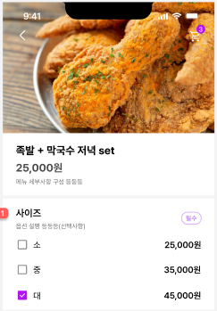

# 3-10 메뉴 선택 후 카트 클릭

[← 미래의 주변상점 - 레거시 로깅 목록](README.md)

플랫폼: ANDROID · IOS  
원문 상태: 로깅 필요

원문에 과거·새 로깅 구분이 없어 아래 정의와 참고사진을 원문 순서로 표시합니다.

원문 미기재 항목: `event_name`, `screen_view`, `event_category`. 값을 추정하지 않았습니다.

메뉴를 선택 후, 우측 상단의  카트로 진입하는 로깅입니다.

event\_params.key

- event\_label : shop\_detail\_menu\_cart

- value : \{상점이름\} 

- event\_category : 

- click 

---

원문 정보

원본 ID: `ab70221954bc823ab16281cc15aa0189`  
[보존 원문](../../_archive/original/notion/pages/ab70221954bc823ab16281cc15aa0189.md)

