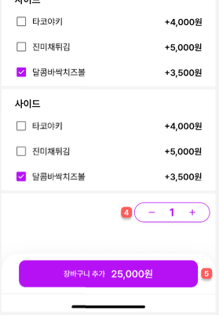

# 3-11 메뉴 선택 후 카트 추가 클릭

[← 미래의 주변상점 - 레거시 목록](README.md)

플랫폼: ANDROID, IOS  
원문 상태: 로깅 필요  
[Notion 기준 명세](https://app.notion.com/p/3290221954bc83c3b03c016d7df65751)  
원본 ID: `3290221954bc83c3b03c016d7df65751`

<!-- notion-body:start -->


메뉴를 선택 후, 하단의 ‘장바구니 추가’를 클릭하는 로깅입니다.

event\_params.key

- event\_label : shop\_detail\_menu\_cart\_add
- value : \{상점이름\}
- event\_category :

    - click
- previous\_page : 메뉴
- current\_page : 메뉴(장바구니 추가)
- duration\_time : 메뉴에 진입하고 장바구니 추가까지 걸리는 시간
<!-- notion-body:end -->

<details>
<summary>Notion 원문 속성 전체</summary>

```json
{
  "platform": [
    "ANDROID",
    "IOS"
  ],
  "url": "https://app.notion.com/p/3290221954bc83c3b03c016d7df65751",
  "상태": "로깅 필요",
  "생성일": "2026-11-23T13:39:17.285Z",
  "이벤트 이름": "3-11 메뉴 선택 후 카트 추가 클릭",
  "태그": [
    "3. 상점 상세 페이지"
  ]
}
```

</details>
