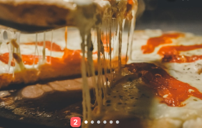

# [레거시] 3-2 상점상세 사진 슬라이드

> **레거시 문서** · 과거 구현과 로깅을 확인하기 위한 보존 자료입니다.

[← 미래의 주변상점 - 레거시 로깅 목록](README.md)

플랫폼: ANDROID · IOS  
원문 상태: 로깅 필요

원문에 과거·새 로깅 구분이 없어 아래 정의와 참고사진을 원문 순서로 표시합니다.

원문 미기재 항목: `event_name`, `screen_view`. 값을 추정하지 않았습니다.

event\_params.key

- event\_label : shop\_picture\_swipe

- value : \{상점이름\} 

- event\_category : swipe

---

---

원문 정보

원본 ID: `4c10221954bc83dcabbb010b55784705`  
[보존 원문](../../_archive/original/notion/pages/4c10221954bc83dcabbb010b55784705.md)

