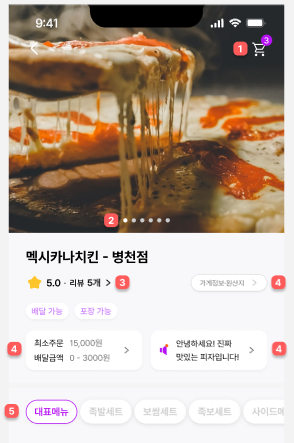

# 3-5 상점상세 상점정보

[← 미래의 주변상점 - 레거시 로깅 목록](README.md)

플랫폼: ANDROID · IOS  
원문 상태: 로깅 필요

원문에 과거·새 로깅 구분이 없어 아래 정의와 참고사진을 원문 순서로 표시합니다.

원문 미기재 항목: `event_name`, `screen_view`, `event_category`. 값을 추정하지 않았습니다.

숫자 4로 표시된 3가지 버튼 모두 동일한 로깅으로 심어주시면 됩니다!

event\_params.key

- event\_label : shop\_detail\_view\_info

- value : \{상점이름\} 

- event\_category : 

- click 

---

추가로 5번에 해당하는 항목은 사장님 및 가게마다 구성이 다를텐데

이 경우는 일일이 로깅을 심어줘야 가능한 일이라 현실적으로 심기 힘든부분이죠??

노션 댓글로 남겨주세요!

---

원문 정보

원본 ID: `90f0221954bc83a99d5481033368cd62`  
[보존 원문](../../_archive/original/notion/pages/90f0221954bc83a99d5481033368cd62.md)

