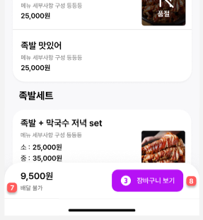

# 3-7 상점상세 카트 클릭(하단)

[← 미래의 주변상점 - 레거시 목록](README.md)

플랫폼: ANDROID, IOS  
원문 상태: 로깅 필요  
[Notion 기준 명세](https://app.notion.com/p/9310221954bc82fd96d1017ac37f7076)  
원본 ID: `9310221954bc82fd96d1017ac37f7076`

<!-- notion-body:start -->


우측 하단에 위치한 카트 진입 로깅입니다(8번)

event\_params.key

- event\_label : shop\_detail\_view\_cart\_view
- value : \{상점이름\}
- event\_category :

    - click
<!-- notion-body:end -->

<details>
<summary>Notion 원문 속성 전체</summary>

```json
{
  "platform": [
    "ANDROID",
    "IOS"
  ],
  "url": "https://app.notion.com/p/9310221954bc82fd96d1017ac37f7076",
  "상태": "로깅 필요",
  "생성일": "2026-11-23T13:39:16.840Z",
  "이벤트 이름": "3-7 상점상세 카트 클릭(하단)",
  "태그": [
    "3. 상점 상세 페이지"
  ]
}
```

</details>
