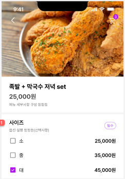

# 3-9-1, 3-9-2 메뉴 선택 후 뒤로 가기

[← 미래의 주변상점 - 레거시 목록](README.md)

플랫폼: ANDROID, IOS  
원문 상태: 로깅 필요  
[Notion 기준 명세](https://app.notion.com/p/5b30221954bc826096d28198237425ea)  
원본 ID: `5b30221954bc826096d28198237425ea`

<!-- notion-body:start -->


메뉴를 선택 후, 좌측 상단의 버튼 또는 스와이프로 이탈 로깅입니다.

event\_params.key

- event\_label : shop\_detail\_menu\_back
- value : \{상점이름\}
- event\_category :

    - click
    - swipe
- previous\_page : \{메뉴\}
- current\_page : \{상점이름\}
- duration\_time : 메뉴에서 상점상세 페이지로 들어간 시간(ms)
<!-- notion-body:end -->

<details>
<summary>Notion 원문 속성 전체</summary>

```json
{
  "platform": [
    "ANDROID",
    "IOS"
  ],
  "url": "https://app.notion.com/p/5b30221954bc826096d28198237425ea",
  "상태": "로깅 필요",
  "생성일": "2026-11-23T13:39:17.002Z",
  "이벤트 이름": "3-9-1, 3-9-2 메뉴 선택 후 뒤로 가기",
  "태그": [
    "3. 상점 상세 페이지"
  ]
}
```

</details>
