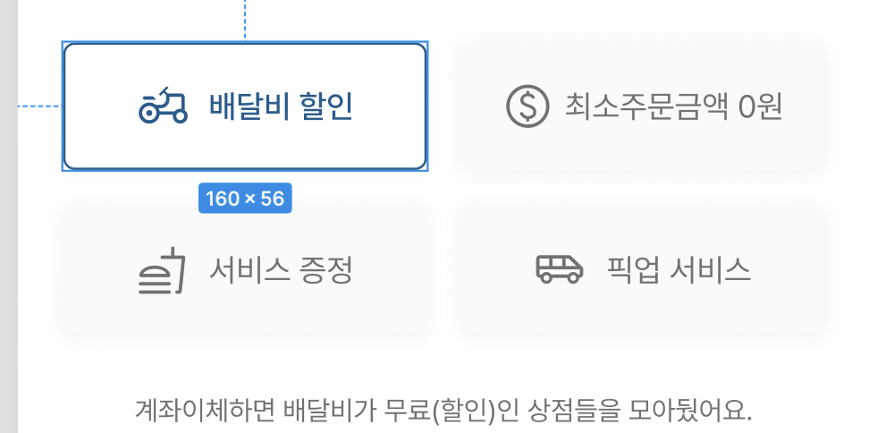

# 4-2 전화 주문 혜택 페이지 버튼 → 버튼 

[← 미래의 주변상점 - 레거시 목록](README.md)

플랫폼: WEB, ANDROID, IOS  
원문 상태: 완료  
[Notion 기준 명세](https://app.notion.com/p/fce0221954bc832bbcb9012c9a587eba)  
원본 ID: `fce0221954bc832bbcb9012c9a587eba`

<!-- notion-body:start -->
event\_params.key

- event\_label : benefit\_shop\_categories
- value : \{버튼\}   //  (배달비, 최소주문금액, 서비스, 픽업)
- event\_category : click <br />
- previous\_page : \{이전카테고리\}
- current\_page : \{현재 카테고리\}
- duration\_time : 이전 카테고리에서 현 카테고리로 이동하는 시간


<!-- notion-body:end -->

<details>
<summary>Notion 원문 속성 전체</summary>

```json
{
  "platform": [
    "WEB",
    "ANDROID",
    "IOS"
  ],
  "url": "https://app.notion.com/p/fce0221954bc832bbcb9012c9a587eba",
  "상태": "완료",
  "생성일": "2026-11-23T13:39:16.407Z",
  "이벤트 이름": "4-2 전화 주문 혜택 페이지 버튼 → 버튼 ",
  "태그": [
    "4. 혜택 페이지"
  ]
}
```

</details>
