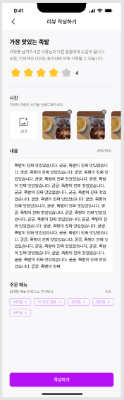

# 5-3 상점상세 리뷰 작성 들어간 후 작성하기 (클릭)  

[← 미래의 주변상점 - 레거시 목록](README.md)

플랫폼: ANDROID, IOS  
원문 상태: 로깅 필요  
[Notion 기준 명세](https://app.notion.com/p/0730221954bc834b8e82818e0e27cd86)  
원본 ID: `0730221954bc834b8e82818e0e27cd86`

<!-- notion-body:start -->


리뷰 작성 페이지에 들어오고 내용 작성 후 작성하기 버튼 클릭 로깅입니다

event\_params.key

- event\_label : shop\_detail\_view\_review\_write\_done
- value : \{상점이름\}
- event\_category : click
- duration\_time : 작성 페이지로 들어와서 쓰기 까지 걸린시간

---
<!-- notion-body:end -->

<details>
<summary>Notion 원문 속성 전체</summary>

```json
{
  "platform": [
    "ANDROID",
    "IOS"
  ],
  "url": "https://app.notion.com/p/0730221954bc834b8e82818e0e27cd86",
  "상태": "로깅 필요",
  "생성일": "2026-11-23T13:39:16.852Z",
  "이벤트 이름": "5-3 상점상세 리뷰 작성 들어간 후 작성하기 (클릭)  ",
  "태그": [
    "5. 리뷰 페이지"
  ]
}
```

</details>
