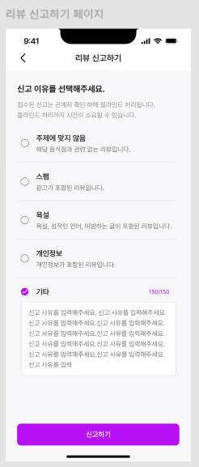

# 5-4 상점상세 리뷰 신고 (클릭) 

[← 미래의 주변상점 - 레거시 목록](README.md)

플랫폼: ANDROID, IOS  
원문 상태: 로깅 필요  
[Notion 기준 명세](https://app.notion.com/p/3b70221954bc82ae83d281c8996af1a6)  
원본 ID: `3b70221954bc82ae83d281c8996af1a6`

<!-- notion-body:start -->


신고 페이지에 들어온 후 사유를 선택하고 신고하기 버튼 클릭 로깅입니다

event\_params.key

- event\_label : shop\_detail\_view\_review\_report
- value

  - 주제에 맞지 않음
  - 스팸
  - 욕설
  - 개인정보
  - 기타 (문자열 값)
- event\_category : click

---
<!-- notion-body:end -->

<details>
<summary>Notion 원문 속성 전체</summary>

```json
{
  "platform": [
    "ANDROID",
    "IOS"
  ],
  "url": "https://app.notion.com/p/3b70221954bc82ae83d281c8996af1a6",
  "상태": "로깅 필요",
  "생성일": "2026-11-23T13:39:16.412Z",
  "이벤트 이름": "5-4 상점상세 리뷰 신고 (클릭) ",
  "태그": [
    "5. 리뷰 페이지"
  ]
}
```

</details>
