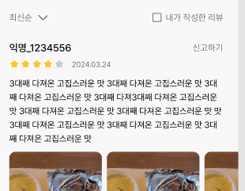
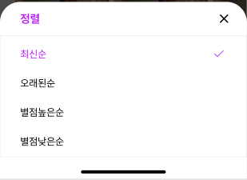

# 5-8 상점상세 리뷰 정렬

[← 미래의 주변상점 - 레거시 목록](README.md)

플랫폼: ANDROID, IOS  
원문 상태: 로깅 필요  
[Notion 기준 명세](https://app.notion.com/p/8520221954bc83c1913c81a365c49a79)  
원본 ID: `8520221954bc83c1913c81a365c49a79`

<!-- notion-body:start -->




정렬 탭을 누르고 4가지 정렬 중 한 정렬을 선택했을 때 로깅입니다

event\_params.key

- event\_label : shop\_detail\_view\_review\_can
- value :

  - 최신순
  - 오래된순
  - 별점높은순
  - 별점낮은순
- event\_category : click

---
<!-- notion-body:end -->

<details>
<summary>Notion 원문 속성 전체</summary>

```json
{
  "platform": [
    "ANDROID",
    "IOS"
  ],
  "url": "https://app.notion.com/p/8520221954bc83c1913c81a365c49a79",
  "상태": "로깅 필요",
  "생성일": "2026-11-23T13:39:16.794Z",
  "이벤트 이름": "5-8 상점상세 리뷰 정렬",
  "태그": [
    "5. 리뷰 페이지"
  ]
}
```

</details>
