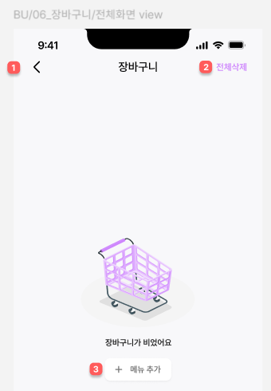

# 6-1 장바구니 진입 후 뒤로가기

[← 미래의 주변상점 - 레거시 목록](README.md)

플랫폼: ANDROID, IOS  
원문 상태: 로깅 필요  
[Notion 기준 명세](https://app.notion.com/p/8320221954bc826cbbed01e1e9d05795)  
원본 ID: `8320221954bc826cbbed01e1e9d05795`

<!-- notion-body:start -->


장바구니 진입 후, 좌측 상단의 버튼 또는 스와이프로 이탈 로깅입니다.

event\_params.key

- event\_label : cart\_back
- value :
- event\_category :

    - click
    - swipe
- previous\_page : 장바구니
- current\_page : \{카테고리\}
- duration\_time : 장바구니에서 머무르는 시간
<!-- notion-body:end -->

<details>
<summary>Notion 원문 속성 전체</summary>

```json
{
  "platform": [
    "ANDROID",
    "IOS"
  ],
  "url": "https://app.notion.com/p/8320221954bc826cbbed01e1e9d05795",
  "상태": "로깅 필요",
  "생성일": "2026-11-23T13:39:16.875Z",
  "이벤트 이름": "6-1 장바구니 진입 후 뒤로가기",
  "태그": [
    "6. 장바구니 페이지"
  ]
}
```

</details>
