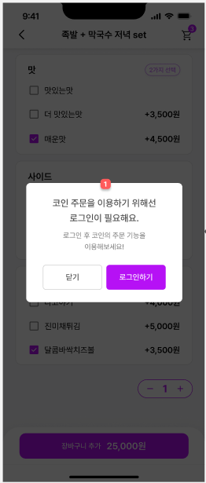

# 6-13 장바구니 비로그인 모달

[← 미래의 주변상점 - 레거시 목록](README.md)

플랫폼: ANDROID, IOS  
원문 상태: 로깅 필요  
[Notion 기준 명세](https://app.notion.com/p/1700221954bc820a82eb0139f8523390)  
원본 ID: `1700221954bc820a82eb0139f8523390`

<!-- notion-body:start -->


event\_params.key

- event\_label : cart\_login\_modal
- value :

  - O
  - X
- event\_category :

    - click
<!-- notion-body:end -->

<details>
<summary>Notion 원문 속성 전체</summary>

```json
{
  "platform": [
    "ANDROID",
    "IOS"
  ],
  "url": "https://app.notion.com/p/1700221954bc820a82eb0139f8523390",
  "상태": "로깅 필요",
  "생성일": "2026-11-23T13:39:18.155Z",
  "이벤트 이름": "6-13 장바구니 비로그인 모달",
  "태그": [
    "6. 장바구니 페이지"
  ]
}
```

</details>
