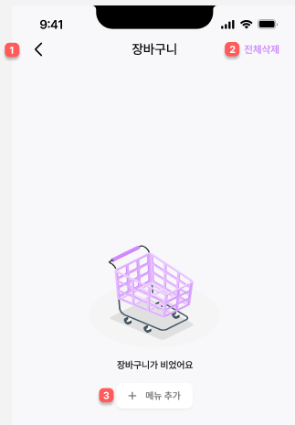

# 6-3 빈 장바구니 메뉴 추가

[← 미래의 주변상점 - 레거시 목록](README.md)

플랫폼: ANDROID, IOS  
원문 상태: 로깅 필요  
[Notion 기준 명세](https://app.notion.com/p/6ba0221954bc83feac0301797d116182)  
원본 ID: `6ba0221954bc83feac0301797d116182`

<!-- notion-body:start -->


빈 장바구니에서 메뉴 추가 클릭 로깅입니다.

event\_params.key

- event\_label : cart\_add\_menu
- value :
- event\_category :

    - click
<!-- notion-body:end -->

<details>
<summary>Notion 원문 속성 전체</summary>

```json
{
  "platform": [
    "ANDROID",
    "IOS"
  ],
  "url": "https://app.notion.com/p/6ba0221954bc83feac0301797d116182",
  "상태": "로깅 필요",
  "생성일": "2026-11-23T13:39:17.019Z",
  "이벤트 이름": "6-3 빈 장바구니 메뉴 추가",
  "태그": [
    "6. 장바구니 페이지"
  ]
}
```

</details>
