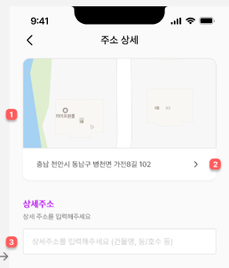

# 7-11 결제 → 교외 주문 페이지 주소 재설정

[← 미래의 주변상점 - 레거시 목록](README.md)

플랫폼: WEB  
원문 상태: 로깅 필요  
[Notion 기준 명세](https://app.notion.com/p/8c40221954bc837c84fb0145a56c9689)  
원본 ID: `8c40221954bc837c84fb0145a56c9689`

<!-- notion-body:start -->


2번. 주소 재설정 버튼 클릭 시 발생 로깅입니다

event\_params.key

- event\_label : payment\_off\_campus\_address\_reset
- value :
- event\_category :
  - click
<!-- notion-body:end -->

<details>
<summary>Notion 원문 속성 전체</summary>

```json
{
  "platform": [
    "WEB"
  ],
  "url": "https://app.notion.com/p/8c40221954bc837c84fb0145a56c9689",
  "상태": "로깅 필요",
  "생성일": "2026-11-23T13:39:18.438Z",
  "이벤트 이름": "7-11 결제 → 교외 주문 페이지 주소 재설정",
  "태그": [
    "7. 결제 페이지"
  ]
}
```

</details>
