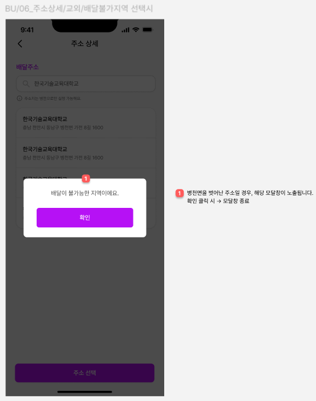

# [레거시] 7-12 결제 → 교외 주문 페이지 배달 불가능 지역

> **레거시 문서** · 과거 구현과 로깅을 확인하기 위한 보존 자료입니다.

[← 미래의 주변상점 - 레거시 로깅 목록](README.md)

플랫폼: WEB  
원문 상태: 로깅 필요

원문에 과거·새 로깅 구분이 없어 아래 정의와 참고사진을 원문 순서로 표시합니다.

원문 미기재 항목: `event_name`, `screen_view`, `value`, `event_category`. 값을 추정하지 않았습니다.

event\_params.key

- event\_label : payment\_off\_campus\_unavailableArea
- value :
- event\_category :
  - click

---

원문 정보

원본 ID: `1a30221954bc82fc9f36014811924a54`  
[보존 원문](../../_archive/original/notion/pages/1a30221954bc82fc9f36014811924a54.md)

