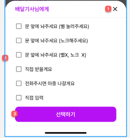

# [레거시] 7-13 결제 → 교내 및 교외 주문 페이지 기사님 요청사항

> **레거시 문서** · 과거 구현과 로깅을 확인하기 위한 보존 자료입니다.

[← 미래의 주변상점 - 레거시 로깅 목록](README.md)

플랫폼: WEB  
원문 상태: 로깅 필요

원문에 과거·새 로깅 구분이 없어 아래 정의와 참고사진을 원문 순서로 표시합니다.

원문 미기재 항목: `event_name`, `screen_view`, `value`, `event_category`. 값을 추정하지 않았습니다.

- 교내 및  교외 주문 페이지에서 동일하게 심어주시면 됩니다!

- 2번 체크박스 선택 후 

- 3번 선택하기까지 클릭 시 발생하는 로깅입니다

event\_params.key

- event\_label : payment\_delivery\_note
- value :

- 문 앞에 놔주세요(벨 눌러주세요)

- 문 앞에 놔주세요(노크 해주세요)

- 문 앞에 놔주세요(벨X, 노크X)

- 직접 받을게요

- 전화주시면 마중 나갈게요

- 직접 입력 

- event\_category :
  - click

---

원문 정보

원본 ID: `4390221954bc8249b07a81d57952c2f5`  
[보존 원문](../../_archive/original/notion/pages/4390221954bc8249b07a81d57952c2f5.md)

