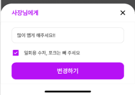

# 7-16 결제 페이지 가게 요청사항 설정

[← 미래의 주변상점 - 레거시 로깅 목록](README.md)

플랫폼: WEB  
원문 상태: 로깅 필요

원문에 과거·새 로깅 구분이 없어 아래 정의와 참고사진을 원문 순서로 표시합니다.

원문 미기재 항목: `event_name`, `screen_view`, `value`, `event_category`. 값을 추정하지 않았습니다.

4번 요청사항 클릭 후 오른쪽 시트가 올라옵니다

아래와 같이 사용자가 입력하는 요청사항과 체크박스 여부를 동시에 value에 넣을 수 있을까요?

문제가 있다면 연락 부탁드리겠습니다!

event\_params.key

- event\_label : payment\_owner\_note

- value : 

- 요청사항, 체크박스O
- 요청사항, 체크박스X

- event\_category :

- click

---

원문 정보

원본 ID: `7710221954bc82ae84e28164677486cf`  
[보존 원문](../../_archive/original/notion/pages/7710221954bc82ae84e28164677486cf.md)

