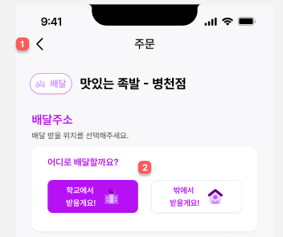

# 7-2 결제 페이지 배달 위치 클릭

[← 미래의 주변상점 - 레거시 로깅 목록](README.md)

플랫폼: WEB  
원문 상태: 로깅 필요

원문에 과거·새 로깅 구분이 없어 아래 정의와 참고사진을 원문 순서로 표시합니다.

원문 미기재 항목: `event_name`, `screen_view`, `event_category`. 값을 추정하지 않았습니다.

2번에 해당

event\_params.key

- event\_label : payment\_deliveryLocation
- value : 교내, 교외
- event\_category :
  - click

---

원문 정보

원본 ID: `74c0221954bc82c9ad67016c115e4f9a`  
[보존 원문](../../_archive/original/notion/pages/74c0221954bc82c9ad67016c115e4f9a.md)

