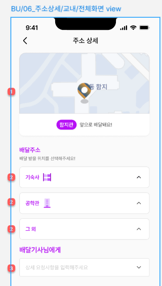

# 7-3 결제 → 교내 주문 페이지 이탈

[← 미래의 주변상점 - 레거시 목록](README.md)

플랫폼: WEB  
원문 상태: 로깅 필요  
[Notion 기준 명세](https://app.notion.com/p/e400221954bc8377968a010d01ee8e6d)  
원본 ID: `e400221954bc8377968a010d01ee8e6d`

<!-- notion-body:start -->


좌측 상단의 교내 주문 페이지 이탈 로깅입니다.

event\_params.key

- event\_label : payment\_campus\_back
- value :
- event\_category :

    - click
    - swipe
- previous\_page : 교내
- current\_page : 결제
- duration\_time : 교내 페이지에서 머무르는 시간
<!-- notion-body:end -->

<details>
<summary>Notion 원문 속성 전체</summary>

```json
{
  "platform": [
    "WEB"
  ],
  "url": "https://app.notion.com/p/e400221954bc8377968a010d01ee8e6d",
  "상태": "로깅 필요",
  "생성일": "2026-11-23T13:39:17.628Z",
  "이벤트 이름": "7-3 결제 → 교내 주문 페이지 이탈",
  "태그": [
    "7. 결제 페이지"
  ]
}
```

</details>
