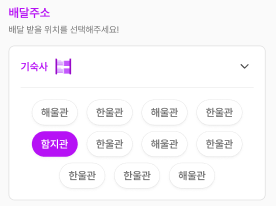

# 7-5 결제 → 교내 주문 페이지 기숙사 위치 설정

[← 미래의 주변상점 - 레거시 목록](README.md)

플랫폼: WEB  
원문 상태: 로깅 필요  
[Notion 기준 명세](https://app.notion.com/p/b340221954bc837e91cb010aed991236)  
원본 ID: `b340221954bc837e91cb010aed991236`

<!-- notion-body:start -->




2번에 해당하고 세부 기숙사 클릭 시 로깅입니다

event\_params.key

- event\_label : payment\_campus\_dormitory
- value : 해울관(101), 예지관(102), 예솔관(103), 다솔관(104), 함지관(105), 한울관(106), 솔빛관(201), 청솔관(202), IH관(203), 은솔관(204), 참빛관(205)
- event\_category :
  - click
<!-- notion-body:end -->

<details>
<summary>Notion 원문 속성 전체</summary>

```json
{
  "platform": [
    "WEB"
  ],
  "url": "https://app.notion.com/p/b340221954bc837e91cb010aed991236",
  "상태": "로깅 필요",
  "생성일": "2026-11-23T13:39:17.812Z",
  "이벤트 이름": "7-5 결제 → 교내 주문 페이지 기숙사 위치 설정",
  "태그": [
    "7. 결제 페이지"
  ]
}
```

</details>
