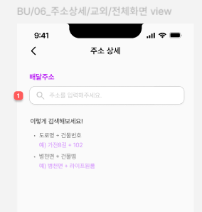

# 7-9 결제 → 교외 주문 페이지 주소 검색 클릭(6월 29일 수정)

[← 미래의 주변상점 - 레거시 목록](README.md)

플랫폼: WEB  
원문 상태: 로깅 필요  
[Notion 기준 명세](https://app.notion.com/p/63e0221954bc83b588b381dc4ad02bfa)  
원본 ID: `63e0221954bc83b588b381dc4ad02bfa`

<!-- notion-body:start -->


주소 창을 클릭했을 때 발생하는 로깅입니다

event\_params.key

- event\_label : payment\_off\_campus\_addressSearch
- value :
- event\_category :

    - click
<!-- notion-body:end -->

<details>
<summary>Notion 원문 속성 전체</summary>

```json
{
  "platform": [
    "WEB"
  ],
  "url": "https://app.notion.com/p/63e0221954bc83b588b381dc4ad02bfa",
  "상태": "로깅 필요",
  "생성일": "2026-11-23T13:39:18.118Z",
  "이벤트 이름": "7-9 결제 → 교외 주문 페이지 주소 검색 클릭(6월 29일 수정)",
  "태그": [
    "7. 결제 페이지"
  ]
}
```

</details>
