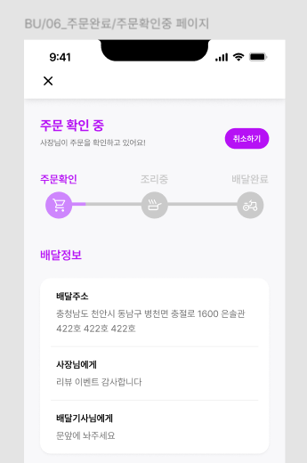
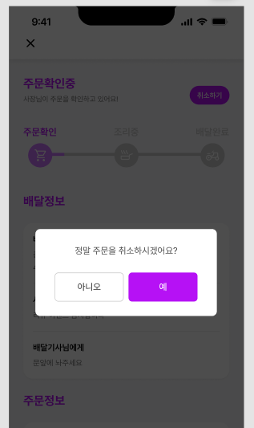
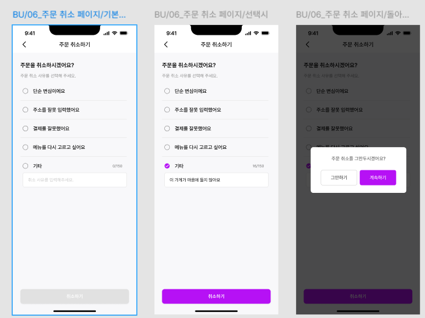

# [레거시] 8-2 주문 완료 페이지 주문 취소하기(6월 29일 수정)

> **레거시 문서** · 과거 구현과 로깅을 확인하기 위한 보존 자료입니다.

[← 미래의 주변상점 - 레거시 로깅 목록](README.md)

플랫폼: WEB  
원문 상태: 로깅 필요

원문에 과거·새 로깅 구분이 없어 아래 정의와 참고사진을 원문 순서로 표시합니다.

원문 미기재 항목: `event_name`, `screen_view`, `value`, `event_category`. 값을 추정하지 않았습니다.

주문 사유를 선택하고 주문 취소 <b>계속하기</b> 버튼 클릭 로깅입니다

event\_params.key

- event\_label : order\_completeCancel
- value :
  - 단순 변심이에요
  - 주소를 잘못 입력했어요
  - 결제를 잘못했어요
  - 메뉴를 다시 고르고 싶어요
  - 기타
    - 해당 문자열 값
- event\_category :
  - click

---

원문 정보

원본 ID: `a0b0221954bc83d59ea2815ed8b2e84f`  
[보존 원문](../../_archive/original/notion/pages/a0b0221954bc83d59ea2815ed8b2e84f.md)

