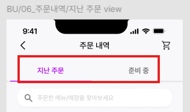

# 9-1 주문내역 상단 탭

[← 미래의 주변상점 - 레거시 목록](README.md)

플랫폼: ANDROID, IOS  
원문 상태: 로깅 필요  
[Notion 기준 명세](https://app.notion.com/p/3770221954bc8219a49a81d33fbca058)  
원본 ID: `3770221954bc8219a49a81d33fbca058`

<!-- notion-body:start -->


event\_params.key

- event\_label : orderHistory\_tabClick
- value :

  - Past Orders
  - Preparing
- event\_category : click
- previous\_page :
- current\_page :
- duration\_time :
<!-- notion-body:end -->

<details>
<summary>Notion 원문 속성 전체</summary>

```json
{
  "platform": [
    "ANDROID",
    "IOS"
  ],
  "url": "https://app.notion.com/p/3770221954bc8219a49a81d33fbca058",
  "상태": "로깅 필요",
  "생성일": "2026-11-23T13:39:18.819Z",
  "이벤트 이름": "9-1 주문내역 상단 탭",
  "태그": [
    "9. 주문내역 페이지"
  ]
}
```

</details>
