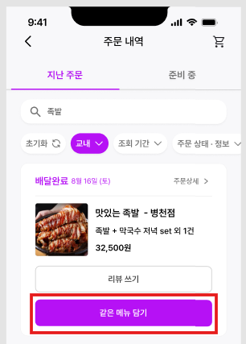

# 9-4 주문내역 검색창 같은 메뉴 담기

[← 미래의 주변상점 - 레거시 목록](README.md)

플랫폼: ANDROID, IOS  
원문 상태: 로깅 필요  
[Notion 기준 명세](https://app.notion.com/p/72e0221954bc8363862181c9cdc03089)  
원본 ID: `72e0221954bc8363862181c9cdc03089`

<!-- notion-body:start -->


검색창에서 텍스트 입력 후 같은 메뉴 담기 버튼 클릭 로깅입니다

event\_params.key

- event\_label : orderHistory\_search\_menuAdd
- value :

  - \{상점이름\}
- event\_category : click
- previous\_page :
- current\_page :
- duration\_time :
<!-- notion-body:end -->

<details>
<summary>Notion 원문 속성 전체</summary>

```json
{
  "platform": [
    "ANDROID",
    "IOS"
  ],
  "url": "https://app.notion.com/p/72e0221954bc8363862181c9cdc03089",
  "상태": "로깅 필요",
  "생성일": "2026-11-23T13:39:20.099Z",
  "이벤트 이름": "9-4 주문내역 검색창 같은 메뉴 담기",
  "태그": [
    "9. 주문내역 페이지"
  ]
}
```

</details>
