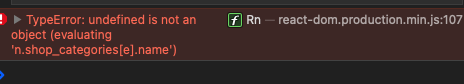

# 해결 (1)

[← 미래의 주변상점 - 레거시 목록](README.md)

플랫폼:   
원문 상태:   
[Notion 기준 명세](https://app.notion.com/p/4b00221954bc83f09e840162c4a0c857)  
원본 ID: `4b00221954bc83f09e840162c4a0c857`

<!-- notion-body:start -->
웹: 

- 헤더나 푸터를 이용하여 주변상점을 들어온뒤 검색 버튼을 누르면 에러가 남.



→ 전체 보기값 을  넣어서 처리해주시면 될 거 같습니다.
<!-- notion-body:end -->

<details>
<summary>Notion 원문 속성 전체</summary>

```json
{
  "title": "해결 (1)"
}
```

</details>
