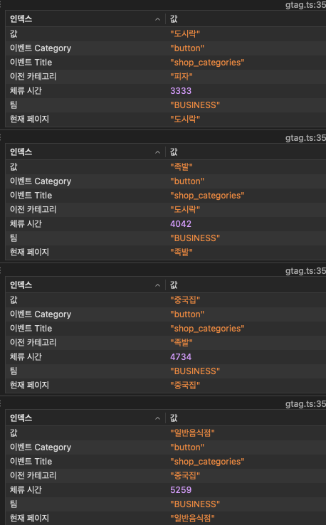
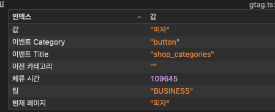

# 해결 (1)

[← 미래의 주변상점 - 레거시 목록](README.md)

플랫폼:   
원문 상태:   
[Notion 기준 명세](https://app.notion.com/p/a860221954bc82e18c06814233be1f3a)  
원본 ID: `a860221954bc82e18c06814233be1f3a`

<!-- notion-body:start -->
---

IOS 

1. 이전 카테고리가 나오지 않는 이슈 <br />


→ 전 카테고리가 나오도록 찍히게 해주세요.

And

- 이전 페이지가 겹치는 이슈 발생.

웹 : 

- 시간이 중복으로 쌓이는 오류



→ 도시락에서 족발로 이동하면 

도시락에서 쌓여있던 시간은 리셋하고 족발에서 다시 카운트 해주시면 감사하겠습니다. 

- 헤더나 푸터를 통해 들어왔을때 이전 카테고리에 공백이 들어오게 됨.



→ 전체보기로 설정해주시면 감사하겠습니다! 

상점카테고리에서 상점 카테고리로의 시간을 파악하고자 합니다. 

주의사항 : 

- scroll 이벤트에는  아래 3개의 키값은 안보내야함.
- 웹에서 배달가능, 카드 가능을 누르게 될경우 페이지가 다르게 잡히는데 이 경우 이벤트가 보내져서는 안됨.

---

안드 

3개 파라미터 추가 안됨.
<!-- notion-body:end -->

<details>
<summary>Notion 원문 속성 전체</summary>

```json
{
  "title": "해결 (1)"
}
```

</details>
