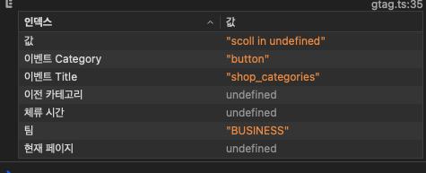
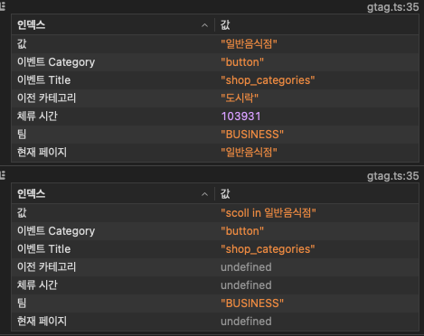

# 해결 (1)

[← 미래의 주변상점 - 레거시 로깅 목록](README.md)

원문에 과거·새 로깅 구분이 없어 아래 정의와 참고사진을 원문 순서로 표시합니다.

원문 미기재 항목: `event_name`, `event_label`, `screen_view`, `value`, `event_category`. 값을 추정하지 않았습니다.

웹: 

<ol>

- 헤더나 푸터를 통하여 주변상점을 들어가게 될때 생기는 문제 

</ol>

→ 헤더나 푸터를 통하여 들어가게 되면 undefined가 아닌 전체보기를 넣어주시면 감사하겠습니다. 

<ol start="2">

- 스크롤 이후 카테고리를 변경하면 자동으로 스크롤 이벤트가 감지되고 있는 이슈 

</ol>

→ 카테고리 변경할 때 안 생기게 처리해주시면 감사하겠습니다…!

---

원문 정보

원본 ID: `fb60221954bc82bf9e1581aeeefb06a3`  
[보존 원문](../../_archive/original/notion/pages/fb60221954bc82bf9e1581aeeefb06a3.md)

