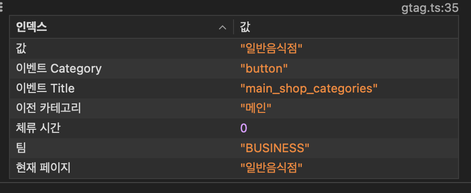

# 해결 

[← 미래의 주변상점 - 레거시 목록](README.md)

플랫폼:   
원문 상태:   
[Notion 기준 명세](https://app.notion.com/p/2db0221954bc8281b49881f9c2794a59)  
원본 ID: `2db0221954bc8281b49881f9c2794a59`

<!-- notion-body:start -->
웹 : 

주변상점에서 메인페이지로 나갔다가 들어온 뒤 카테고리를 누르면 체류 시간이 0 혹은 1로 나오는 이슈 



→ 뒤로가기를 한 뒤 다시 들어와도 시간이 찍히게 바꿔주시면 감사하겠습니다. 

---

안드로이드 : 

시간 : ms → S
<!-- notion-body:end -->

<details>
<summary>Notion 원문 속성 전체</summary>

```json
{
  "title": "해결 "
}
```

</details>
