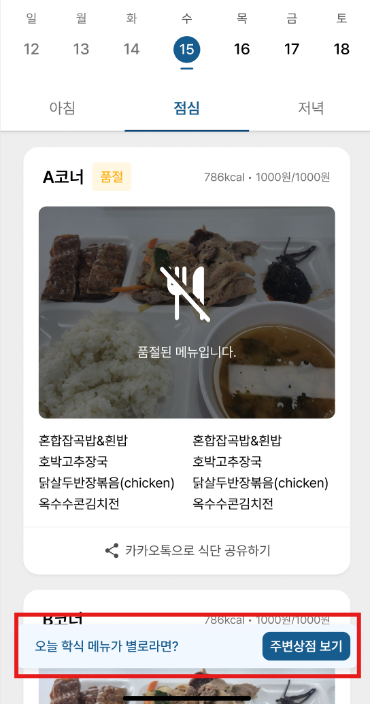

# 0-1. 식단_ABtest_상점가기_클릭 - 레거시

[← 식단 목록](README.md)

플랫폼: ANDROID, IOS, WEB  
원문 상태: 완료  
[Notion 기준 명세](https://app.notion.com/p/ae90221954bc8243bf49018115c1b22a)  
원본 ID: `ae90221954bc8243bf49018115c1b22a`

<!-- notion-body:start -->
## 과거 로깅

- event\_label : “dining\_to\_shop”
- value : “\{아침 or 점심 or 저녁\}<b>”</b>
- event\_category : “click”
- 설명: 학식 화면에서 상점 화면으로 가는 버튼 클릭 시 발생하는 이벤트입니다.
- custom\_session\_id : \{dining2shop\}\_\{0\}\_\{플랫폼\}\_\{세션시작시간\}\_\{랜덤값\}
- 참고사진


<!-- notion-body:end -->

<details>
<summary>Notion 원문 속성 전체</summary>

```json
{
  "platform": [
    "ANDROID",
    "IOS",
    "WEB"
  ],
  "url": "https://app.notion.com/p/ae90221954bc8243bf49018115c1b22a",
  "상태": "완료",
  "생성일": "2026-11-23T13:38:24.917Z",
  "이름": "0-1. 식단\\_ABtest\\_상점가기\\_클릭 - 레거시",
  "태그": [
    "0. A/B TEST"
  ]
}
```

</details>
