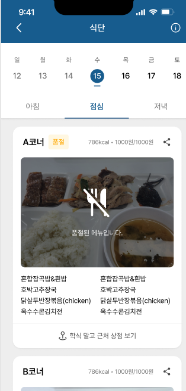

# [레거시] 0-2. 식단_ABtest_진입 - 레거시

> **레거시 문서** · 과거 구현과 로깅을 확인하기 위한 보존 자료입니다.

[← 식단 로깅 목록](README.md)

플랫폼: ANDROID · IOS · WEB  
원문 상태: 완료

과거 로깅·새 로깅과 각 참고사진은 원문의 구간별 연결을 유지합니다.

원문 미기재 항목: `screen_view`. 값을 추정하지 않았습니다.

<!-- logging-section:past:start -->
## 과거 로깅

- 설명: 사용자가 앱을 키는 순간 생성되는 이벤트입니다.
- event\_name : “AB\_TEST”
- event\_category : “a/b test 로깅(메인화면 식단 진입)”
- event\_label : “dining2shop\_1”
- value : design\_A / design\_B
- custom\_session\_id : \{dining2shop\}\_\{0\}\_\{플랫폼\}\_\{세션시작시간\}\_\{랜덤값\}

커스텀 세션 아이디 - 원문 (원문 ID: 2759ae650b5980f1bc4fee4a1a377139) 

- A안(control group)

- B안(variant group)

<!-- logging-section:past:end -->

---

원문 정보

원본 ID: `3470221954bc83879704817579bcb39f`  
[보존 원문](../../_archive/original/notion/pages/3470221954bc83879704817579bcb39f.md)

