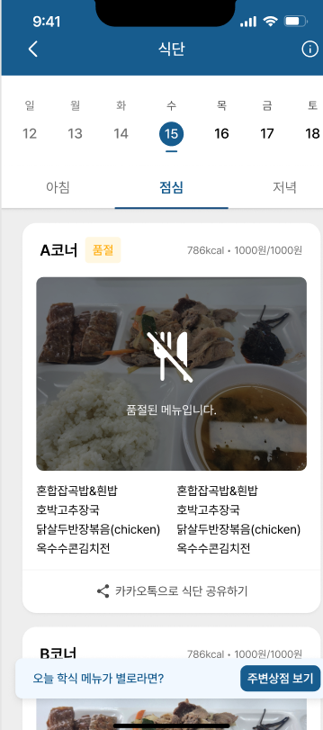

# 0-2. 식단_ABtest_진입 - 레거시

[← 식단 목록](README.md)

플랫폼: ANDROID, IOS, WEB  
원문 상태: 완료  
[Notion 기준 명세](https://app.notion.com/p/c140221954bc8286a52881ec296b497b)  
원본 ID: `c140221954bc8286a52881ec296b497b`

<!-- notion-body:start -->
## 과거 로깅

- 설명: 사용자가 앱을 키는 순간 생성되는 이벤트입니다.
- event\_name : “AB\_TEST”
- event\_category : “a/b test 로깅(메인화면 식단 진입)”
- event\_label : “dining2shop\_1”
- value : design\_A / design\_B
- custom\_session\_id : \{dining2shop\}\_\{0\}\_\{플랫폼\}\_\{세션시작시간\}\_\{랜덤값\}

커스텀 세션 아이디 - [Notion 원문](https://app.notion.com/p/2759ae650b5980f1bc4fee4a1a377139) 

- A안(control group)


- B안(variant group)


<!-- notion-body:end -->

<details>
<summary>Notion 원문 속성 전체</summary>

```json
{
  "platform": [
    "ANDROID",
    "IOS",
    "WEB"
  ],
  "url": "https://app.notion.com/p/c140221954bc8286a52881ec296b497b",
  "상태": "완료",
  "생성일": "2026-11-23T13:38:24.761Z",
  "이름": "0-2. 식단\\_ABtest\\_진입 - 레거시",
  "태그": [
    "0. A/B TEST"
  ]
}
```

</details>
