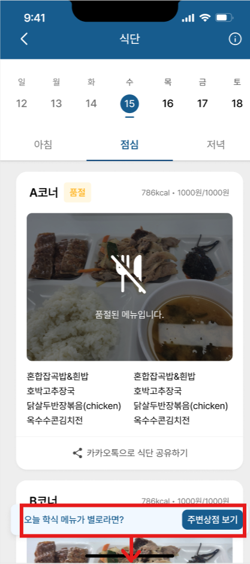

# 0-3. 식단_ABtest_상점가기_닫기 - 레거시

[← 식단 목록](README.md)

플랫폼: ANDROID, IOS  
원문 상태: 완료  
[Notion 기준 명세](https://app.notion.com/p/69b0221954bc82b8af6a813c4d006856)  
원본 ID: `69b0221954bc82b8af6a813c4d006856`

<!-- notion-body:start -->
## 과거 로깅

- event\_label : “dining\_to\_shop\_close”
- value : “\{아침 or 점심 or 저녁\}<b>”</b>
- event\_category : “swipe”
- custom\_session\_id : \{dining2shop\}\_\{0\}\_\{플랫폼\}\_\{세션시작시간\}\_\{랜덤값\}
- 세션 설명: 커스텀 세션 아이디는 0-1과 같이 세션 아이디를 유지하는 방식으로 작업해주시면 됩니다.
- 로깅 설명: 상점 바로가기 버튼을 아래로 내려 없앨 때 발생하는 이벤트입니다.
- 참고사진


<!-- notion-body:end -->

<details>
<summary>Notion 원문 속성 전체</summary>

```json
{
  "platform": [
    "ANDROID",
    "IOS"
  ],
  "url": "https://app.notion.com/p/69b0221954bc82b8af6a813c4d006856",
  "상태": "완료",
  "생성일": "2026-11-23T13:38:26.383Z",
  "이름": "0-3. 식단\\_ABtest\\_상점가기\\_닫기 - 레거시",
  "태그": [
    "0. A/B TEST"
  ]
}
```

</details>
