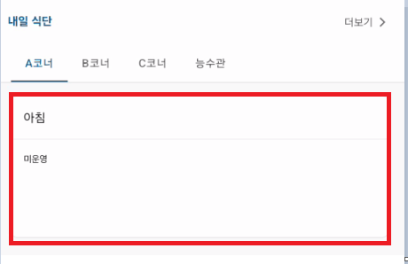
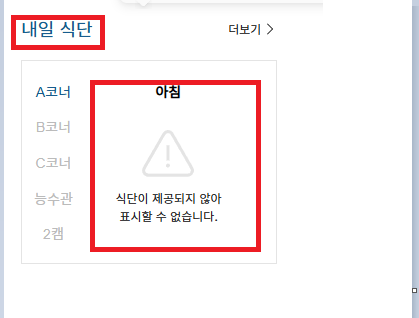
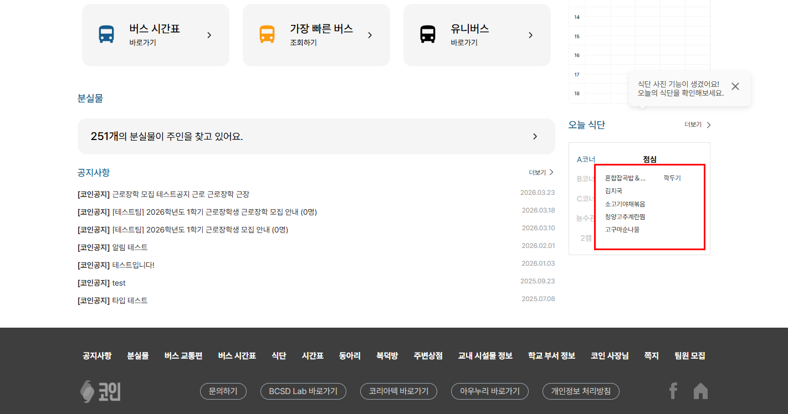

# 1-2.메인_식단_클릭 (레거시)

[← 식단 목록](README.md)

플랫폼: ANDROID, IOS, WEB, WEB (모바일)  
원문 상태: 완료  
[Notion 기준 명세](https://app.notion.com/p/b9f0221954bc825e98dc018bf2e3e6e5)  
원본 ID: `b9f0221954bc825e98dc018bf2e3e6e5`

<!-- notion-body:start -->
## 과거 로깅

- 설명 : 메인화면에서 식단 칸 클릭
- event\_label : “main\_menu\_moveDetailView”
- value : “오늘 식단, 내일 식단<b>”</b>
- event\_category : “click”
- 참고사진



- 웹
- 웹은 내일 식단 버튼 부분 포함



- 설명: 홈의 일반 식단 카드 본문을 눌러 식단 페이지로 진입할 때 기록한다. PC 웹의 식단 제목, 전체보기·더보기 버튼, 코너 선택, 카드 단순 노출은 포함하지 않는다. 구 WEB의 오늘·내일 식단 제목 버튼과 iOS 빈 상태 안내 카드는 검토사항의 별도 경로를 따른다.
- screen\_view: <code>main</code>
- event\_name: <code>DA1</code>
- event\_label: <code>cafeteria__main__meal__click</code>
- value: 아침 / 점심 / 저녁 (예: 점심)
- event\_category: <code>click</code>



## 새 로깅

레거시. [1-3 메인 식단 진입 클릭](https://app.notion.com/p/1900221954bc83fc825c011c5fbaad93)으로 통합한다.
<!-- notion-body:end -->

<details>
<summary>Notion 원문 속성 전체</summary>

```json
{
  "platform": [
    "ANDROID",
    "IOS",
    "WEB",
    "WEB (모바일)"
  ],
  "url": "https://app.notion.com/p/b9f0221954bc825e98dc018bf2e3e6e5",
  "상태": "완료",
  "생성일": "2026-11-23T13:38:22.086Z",
  "이름": "1-2.메인\\_식단\\_클릭 (레거시)",
  "태그": [
    "1. 메인_식단"
  ]
}
```

</details>
