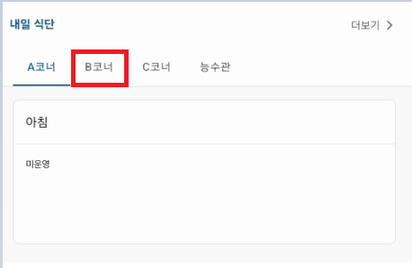
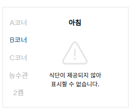

# 1-4.메인_식단_B코너_클릭

[← 식단 목록](README.md)

플랫폼: ANDROID, IOS, WEB  
원문 상태: 완료  
[Notion 기준 명세](https://app.notion.com/p/63c0221954bc8244a74481cf49b740ef)  
원본 ID: `63c0221954bc8244a74481cf49b740ef`

<!-- notion-body:start -->
## 과거 로깅

- 설명 : 메인화면에서 B코너 버튼 클릭
- event\_label : “main\_menu\_corner”
- value : “B코너<b>”</b>
- event\_category : “click”
- 참고사진



- 웹



## 새 로깅

- 레거시: 코너별로 나뉘어 있던 메인 식단 코너 클릭을 1-3 하나의 라벨로 합치고 코너는 value로 구분한다. 새 로깅을 만들지 않는다.
- 대체 로깅 : 1-3.메인\_식단\_A코너\_클릭 (cafeteria\_\_main\_\_corner\_\_select)

### 참고사진 (레거시)

<b>웹</b>

<b>참고사진 · 웹</b>

해당 없음 (레거시)

<b>모바일</b>

<b>참고사진 · 모바일</b>

해당 없음 (레거시)
<!-- notion-body:end -->

<details>
<summary>Notion 원문 속성 전체</summary>

```json
{
  "platform": [
    "ANDROID",
    "IOS",
    "WEB"
  ],
  "url": "https://app.notion.com/p/63c0221954bc8244a74481cf49b740ef",
  "상태": "완료",
  "생성일": "2026-11-23T13:38:22.374Z",
  "이름": "1-4.메인\\_식단\\_B코너\\_클릭",
  "태그": [
    "1. 메인_식단"
  ]
}
```

</details>
