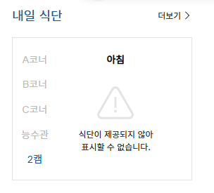

# 1-7.메인_식단_2캠퍼스_클릭

[← 식단 로깅 목록](README.md)

플랫폼: WEB  
원문 상태: 완료

과거 로깅·새 로깅과 각 참고사진은 원문의 구간별 연결을 유지합니다.

원문 미기재 항목: `event_name`, `screen_view`. 값을 추정하지 않았습니다.

<!-- logging-section:past:start -->
## 과거 로깅

- 설명 : 메인화면에서 2캠퍼스 버튼 클릭
- event\_label : “main\_menu\_corner”
- value : “2캠퍼스<b>”</b>
- event\_category : “click”
- 참고사진
- 웹

<!-- logging-section:past:end -->

<!-- logging-section:new:start -->
## 새 로깅

- 레거시: 코너별로 나뉘어 있던 메인 식단 코너 클릭을 1-3 하나의 라벨로 합치고 코너는 value로 구분한다(2캠퍼스도 value). 새 로깅을 만들지 않는다.
- 대체 로깅 : 1-3.메인\_식단\_A코너\_클릭 (cafeteria\_\_main\_\_corner\_\_select)

### 참고사진 (레거시)

<b>웹</b>

<b>참고사진 · 웹</b>

해당 없음 (레거시)

<b>모바일</b>

<b>참고사진 · 모바일</b>

해당 없음 (레거시, 웹 전용 버튼)

<!-- logging-section:new:end -->

---

원문 정보

원본 ID: `15e0221954bc835a969901001f9897ae`  
[보존 원문](../../_archive/original/notion/pages/15e0221954bc835a969901001f9897ae.md)

