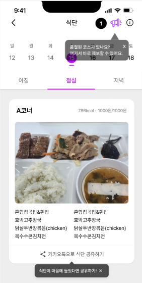
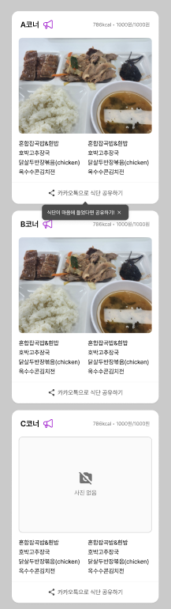

# 1. 품절 제보 버튼_식단 진입

[← 식단 목록](README.md)

플랫폼: ANDROID, IOS, WEB  
원문 상태: 로깅 필요  
[Notion 기준 명세](https://app.notion.com/p/f130221954bc82869d1801c00916d5d2)  
원본 ID: `f130221954bc82869d1801c00916d5d2`

<!-- notion-body:start -->
## 과거 로깅

없음 (새로 추가한 로깅)

## 새 로깅

- 설명: 사용자가 식단 화면에 진입(홈화면에서 식단으로 진입 or 카테고리에서 식단으로 진입) 하는 순간 생성되는 이벤트입니다.
- screen\_view: <code>cafeteria</code>
- event\_name: <code>DA1</code>
- event\_label: <code>cafeteria__dining__abtest__exposure</code>
- value: A안 / B안
- event\_category: <code>exposure</code>

### 참고사진 (품절 제보 버튼 A/B 식단 진입)

<b>웹</b>

<b>참고사진 · 웹</b>

웹 — 사진 없음 (추가 필요)

<b>모바일</b>

<b>참고사진 · 모바일</b>

모바일 — A안 시안



모바일 — B안 시안


<!-- notion-body:end -->

<details>
<summary>Notion 원문 속성 전체</summary>

```json
{
  "platform": [
    "ANDROID",
    "IOS",
    "WEB"
  ],
  "url": "https://app.notion.com/p/f130221954bc82869d1801c00916d5d2",
  "상태": "로깅 필요",
  "생성일": "2026-11-23T13:38:26.746Z",
  "이름": "1. 품절 제보 버튼\\_식단 진입",
  "태그": [
    "0. A/B TEST"
  ]
}
```

</details>
