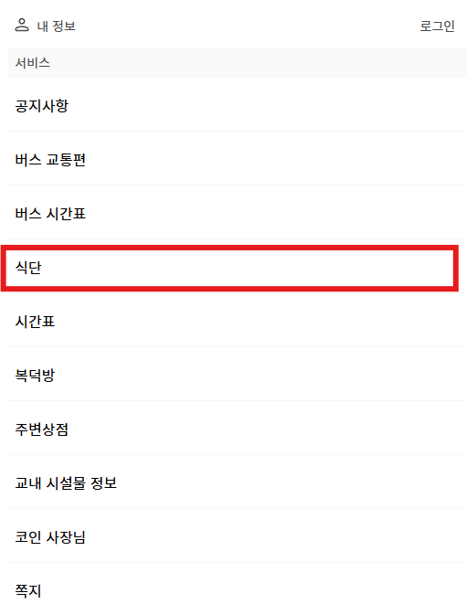

# 2-3. 햄버거_식단_클릭 (레거시)

[← 식단 목록](README.md)

플랫폼: ANDROID, IOS, WEB  
원문 상태: 완료  
[Notion 기준 명세](https://app.notion.com/p/ebc0221954bc834e9ab381b45b95ffca)  
원본 ID: `ebc0221954bc834e9ab381b45b95ffca`

<!-- notion-body:start -->
2026-11-08 이 옛 앱 햄버거 명세의 삭제·레거시 결정은 유지한다. 현재 모바일 WEB /category의 식단 메뉴는 [Notion 원문](https://app.notion.com/p/4120221954bc817faa33c64ee9f9ad13)의 새 계약을 따른다. PC 헤더·홈 카드 라벨을 대신 보내거나 이 옛 명세를 되살리지 않는다. SDK 배포·실수집 검수는 별도다.

## 이전 로깅

- event\_label : “hamburger”
- value : “식단<b>”</b>
- event\_category : “click”
- 참고사진


<!-- notion-body:end -->

<details>
<summary>Notion 원문 속성 전체</summary>

```json
{
  "platform": [
    "ANDROID",
    "IOS",
    "WEB"
  ],
  "url": "https://app.notion.com/p/ebc0221954bc834e9ab381b45b95ffca",
  "상태": "완료",
  "생성일": "2026-11-23T13:38:25.081Z",
  "이름": "2-3. 햄버거\\_식단\\_클릭 (레거시)",
  "태그": [
    "2. 헤더/푸터/햄버거_식단"
  ]
}
```

</details>
