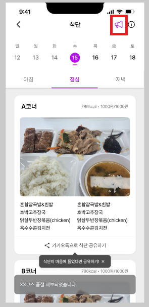
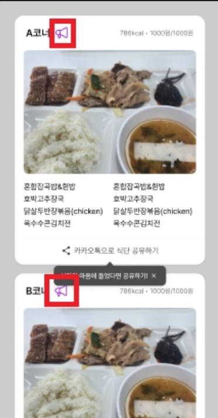

# 2. 품절 제보 버튼_버튼 클릭

[← 식단 목록](README.md)

플랫폼: ANDROID, IOS, WEB  
원문 상태: 로깅 필요  
[Notion 기준 명세](https://app.notion.com/p/3240221954bc839db9b98179866c3090)  
원본 ID: `3240221954bc839db9b98179866c3090`

<!-- notion-body:start -->
## 과거 로깅

없음 (새로 추가한 로깅)

## 새 로깅

- screen\_view: <code>cafeteria</code>
- event\_name: <code>DA1</code>
- event\_label: <code>cafeteria__dining__soldout__start</code>
- value:
  - A안
  - B안\_\{A코너 or B코너 등등\}
- event\_category: <code>click</code>

### 참고사진 (품절 제보 버튼 클릭)

<b>웹</b>

<b>참고사진 · 웹</b>

웹 — 사진 없음 (추가 필요)

<b>모바일</b>

<b>참고사진 · 모바일</b>

모바일 — A안 시안



모바일 — B안 시안


<!-- notion-body:end -->

<details>
<summary>Notion 원문 속성 전체</summary>

```json
{
  "platform": [
    "ANDROID",
    "IOS",
    "WEB"
  ],
  "url": "https://app.notion.com/p/3240221954bc839db9b98179866c3090",
  "상태": "로깅 필요",
  "생성일": "2026-11-23T13:38:25.996Z",
  "이름": "2. 품절 제보 버튼\\_버튼 클릭",
  "태그": [
    "0. A/B TEST"
  ]
}
```

</details>
