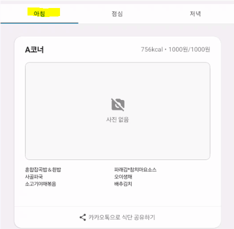
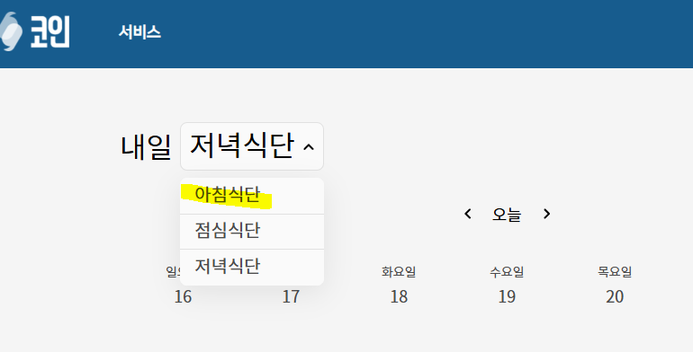
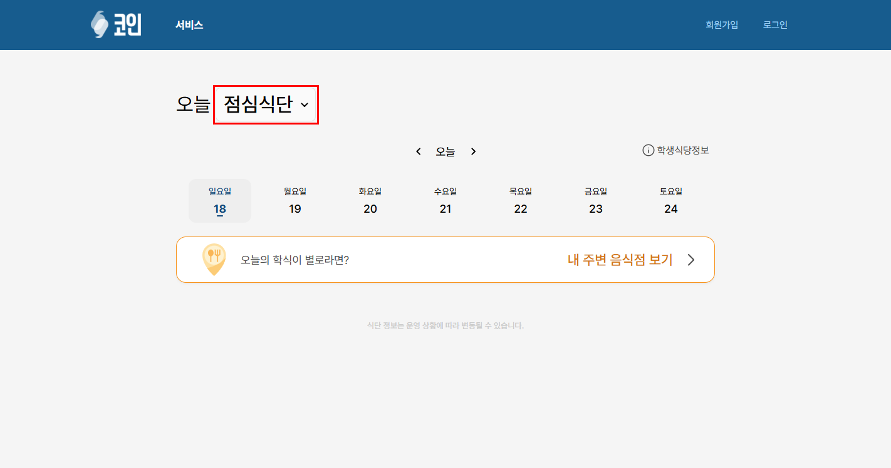
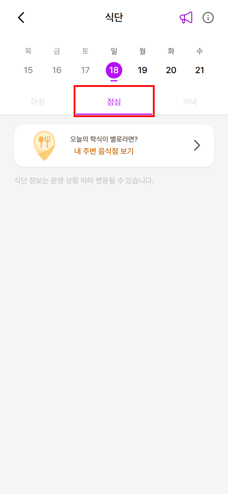

# 3-1. 식단_식사시간 선택 (클릭) - 3-2·3-3 통합

[← 식단 목록](README.md)

플랫폼: ANDROID, IOS, WEB  
원문 상태: 완료  
[Notion 기준 명세](https://app.notion.com/p/0e60221954bc82dbbcbf019100dba7ae)  
원본 ID: `0e60221954bc82dbbcbf019100dba7ae`

<!-- notion-body:start -->
## 과거 로깅

- 설명 : 식단페이지에서 아침 버튼 클릭
- event\_label : “menu\_time”
- value : “아침<b>”</b>
- event\_category : “click”
- 참고사진



- 웹



## 새 로깅

- 설명: 식단 화면에서 아침 / 점심 / 저녁 탭(web은 식사 시간 드롭다운) 중 하나를 선택해 해당 식사 시간의 식단을 보는 경우 (기존 3-1·3-2·3-3을 하나로 통합)
- screen\_view: <code>cafeteria</code>
- event\_name: <code>DA1</code>
- event\_label: <code>cafeteria__cafeteria__meal_time__select</code>
- value: 아침 / 점심 / 저녁 (예: 점심)
- event\_category: <code>select</code>

### 참고사진 (식사시간 선택)

<b>웹</b>

<b>참고사진 · 웹</b>

웹 — 식사 시간 드롭다운 선택 (출처: stage 실제 캡처, 빨간 네모 = 클릭 위치)



<b>모바일</b>

<b>참고사진 · 모바일</b>

모바일 — 아침 / 점심 / 저녁 탭 선택 (출처: stage 실제 캡처, 빨간 네모 = 클릭 위치)


<!-- notion-body:end -->

<details>
<summary>Notion 원문 속성 전체</summary>

```json
{
  "platform": [
    "ANDROID",
    "IOS",
    "WEB"
  ],
  "url": "https://app.notion.com/p/0e60221954bc82dbbcbf019100dba7ae",
  "상태": "완료",
  "생성일": "2026-11-23T13:38:25.631Z",
  "이름": "3-1. 식단\\_식사시간 선택 (클릭) - 3-2·3-3 통합",
  "태그": [
    "3. 식단 상세페이지"
  ]
}
```

</details>
